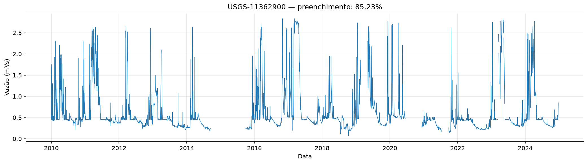

# USGS Streamflow

Projeto colaborativo de preparação e análise de séries temporais de vazão de rios a partir de dados públicos do **U.S. Geological Survey (USGS)**. O repositório reúne notebooks de exploração e coleta, módulos Python reutilizáveis e figuras produzidas durante as análises.

O trabalho está em fase de preparação e avaliação dos dados. **Ainda não há um modelo de reconstrução de vazões, uma PINN ou um modelo generativo implementado.** Uma decisão metodológica em andamento é comparar a adequação de dados diários com dados de maior frequência (intradiários) para a modelagem; a frequência de 15 minutos não é assumida como disponível ou preferível para todas as estações.

## O que já foi feito

- Exploração da API OGC da USGS Water Data e consulta dos esquemas das coleções, para identificar campos disponíveis.
- Construção de catálogo de séries e estações com metadados como localização, período de registro, área de drenagem e unidade hidrológica.
- Seleção configurável de séries de vazão diária e download em lotes, com cache local em Parquet para reaproveitar os dados.
- Preparação exploratória de uma grade diária por série no notebook de coleta. A grade mantém dias sem observação como ausentes, sem imputá-los.
- Implementação de módulos para ler e validar catálogos e caches Parquet, montar tabelas de observações diárias, resumir cobertura e gerar gráficos.
- Geração de tabelas locais relacionadas à seleção de estações, candidatos sem vazão diária zero, metadados de séries contínuas e pares de estações.
- Armazenamento de **61 figuras** de séries temporais em `reports/figure/figuras_series_temporais/`.

Esses itens descrevem o estado encontrado nos arquivos locais. Os dados e caches gerados são ignorados pelo Git e, portanto, não acompanham o repositório clonado.

## Fonte e configuração dos dados diários

O notebook [`usgs_streamflow.ipynb`](usgs_streamflow/notebooks/usgs_streamflow.ipynb) usa a API OGC da USGS. Seus parâmetros atuais incluem:

| Parâmetro | Configuração atual | Interpretação |
|---|---|---|
| Versão do endpoint | `v0` | Versão da API configurada no código atual; não é uma garantia de compatibilidade futura. Os esquemas devem ser conferidos novamente se a versão mudar. |
| Período | `2010-01-01` a `2024-12-31` | Janela usada para a seleção e as consultas diárias desse notebook. |
| Código do parâmetro | `00060` | Vazão (*discharge*), fornecida pela USGS em `ft³/s` nessa coleção. |
| Código da estatística | `00003` | Média diária; não é uma medição instantânea. |
| Completude mínima | `0.95` | Parâmetro do notebook para a fração mínima de dias presentes considerada na seleção final. |

O notebook consulta principalmente:

- `time-series-metadata`: características e período de registro de cada série;
- `monitoring-locations`: identificação e metadados do local monitorado;
- `daily`: observações diárias de vazão.

Uma estação física pode ter várias séries. `monitoring_location_id` identifica o local; `time_series_id` identifica a série específica e relaciona seus metadados às observações.

### Ausência de dados e valores zero

Na grade `df_full`, uma linha é criada para cada série selecionada e cada data do período. Assim, o projeto consegue distinguir:

- **vazão zero**: valor medido igual a zero, que continua sendo uma observação válida;
- **dia sem linha retornada**: a API não retornou uma observação para a série/data;
- **linha retornada sem valor numérico utilizável**: existe registro, mas a vazão é ausente.

O notebook mantém `NaN` em vez de preencher ou interpolar esses casos. `record_returned` indica se a API retornou uma linha, e `is_missing` indica valor de vazão ausente. A vazão também é convertida de `ft³/s` para `m³/s` em `value_m3s`, sem preencher valores ausentes.

## Frequência diária ou intradiária

A base diária é o fluxo atualmente implementado no notebook de coleta. Há também arquivos locais e tabelas relacionados à coleção `continuous`, que fornece observações de maior frequência, mas o intervalo real e a cobertura variam por série, estação e parâmetro.

A comparação entre dados diários e intradiários **continua em investigação**. Antes de escolher a resolução para a modelagem, é necessário verificar a frequência efetiva, as lacunas, os qualificadores, a cobertura espacial e a compatibilidade com as variáveis auxiliares. Não se deve presumir que toda série contínua tenha intervalo de 15 minutos. No estado atual do repositório, os dois notebooks versionados são os listados abaixo; não foi encontrado um notebook versionado que reproduza uma rotina completa de coleta intradiária.

## Estrutura do repositório

```text
usgs_dados_streamflow/
├── README.md
├── reports/
│   └── figure/
│       └── figuras_series_temporais/   # figuras PNG produzidas
└── usgs_streamflow/
    ├── .env.example                    # exemplo de variável de ambiente
    ├── .gitignore                      # ignora dados locais, ambiente e caches
    ├── requirements.txt
    ├── notebooks/
    │   ├── usgs_streamflow.ipynb       # consulta à API e exploração diária
    │   └── análise_seleção.ipynb        # análise local de caches existentes
    ├── src/
    │   ├── api.py
    │   ├── catalog.py
    │   ├── config.py
    │   ├── main.py
    │   ├── plots.py
    │   └── processing.py
    └── data/                            # dados locais; não versionados
```

### Código Python

- `src/config.py`: define os caminhos de `data/` e as configurações da API; lê `.env` se existir.
- `src/api.py`: cliente opcional da API OGC, com paginação e novas tentativas para erros temporários e limite de requisições. Os fluxos locais de análise não chamam esse cliente implicitamente.
- `src/catalog.py`: lista e carrega CSV/Parquet dentro da pasta de dados, valida a seleção de estações e lê os caches diários. As exportações são criadas em `data/exports/` e não sobrescrevem arquivos existentes.
- `src/processing.py`: relaciona observações às estações, mantém apenas dias já observados e calcula resumos por estação.
- `src/plots.py`: cria gráfico temporal para uma estação.
- `src/main.py`: combina carregamento, processamento e resumo para uso no notebook.

### Notebooks

1. **[`usgs_streamflow.ipynb`](usgs_streamflow/notebooks/usgs_streamflow.ipynb)** — consulta os esquemas da API, constrói o catálogo, seleciona séries e baixa vazões diárias em lotes com cache Parquet. Forma `df_full` em memória com a grade de datas, metadados e indicadores de ausência.
2. **[`análise_seleção.ipynb`](usgs_streamflow/notebooks/análise_seleção.ipynb)** — usa os módulos de `src/` para indexar os arquivos locais, montar uma tabela longa com observações existentes, resumir cobertura por estação e visualizar uma estação. Não consulta a API nem cria linhas para dias ausentes.

## Dados gerados e reprodutibilidade

O `.gitignore` dentro de `usgs_streamflow/` contém a regra `data/`; por isso, **todo o conteúdo dessa pasta é ignorado**, inclusive arquivos processados, catálogos CSV e caches Parquet. `.env`, `.venv/`, `__pycache__/` e `.ipynb_checkpoints/` também são ignorados.

Exemplos de arquivos gerados localmente incluem:

- `data/usgs/raw/`: catálogo e lotes diários em Parquet;
- `data/usgs/raw/continuous/`: caches locais de observações da coleção `continuous`;
- `data/usgs/processed/catalog_stations.csv`: catálogo de estações;
- `data/usgs/processed/stations_no_zero_continuous_candidates.csv`: resumo de estações candidatas com observações diárias e sem zeros;
- `data/usgs/processed/continuous_series_catalog.csv`: metadados de séries contínuas;
- `data/usgs/processed/pares_nldi_UM_150km.csv` e `pares_nldi_UT_150km.csv`: pares de estações registrados nos recortes correspondentes;
- `data/usgs/processed/stations_full.parquet`: seleção consumida pelo notebook de análise local.

**Atenção ao clonar:** esses arquivos não estarão no GitHub. O notebook de análise local precisa de `stations_full.parquet` e dos Parquets diários compatíveis com o período e os códigos configurados. No código analisado, o notebook de coleta cria `selected`/`stations_full` em memória, mas não salva automaticamente `stations_full.parquet`; a origem desse arquivo precisa ser providenciada para reproduzir o segundo notebook em uma instalação limpa. Guarde dados necessários fora do repositório ou gere/provisione esses arquivos localmente; não remova a regra `data/` sem antes avaliar o tamanho e a política de compartilhamento dos dados.

## Instalação

Os comandos a seguir são para Git Bash no Windows, a partir da raiz do repositório:

```bash
cd usgs_streamflow
python -m venv .venv
source .venv/Scripts/activate
python -m pip install -r requirements.txt
```

No VS Code, selecione o interpretador e o kernel Jupyter da pasta `usgs_streamflow/.venv`.

### Chave da API

A configuração do código aceita `USGS_API_KEY`; a chave é opcional no cliente atual, mas pode ser útil para limites de uso da API. Se você tiver uma chave, copie o exemplo e edite o arquivo local:

```bash
cp .env.example .env
```

Substitua o valor de exemplo por sua chave. **Nunca compartilhe nem faça commit do `.env`.** O arquivo `.env.example` contém apenas um marcador de exemplo.

## Como executar

Para coletar/atualizar o fluxo diário, abra `usgs_streamflow/notebooks/usgs_streamflow.ipynb` no VS Code e execute as células em ordem. A execução faz solicitações à API e grava caches locais em `usgs_streamflow/data/usgs/`; o tempo e o volume dependem da quantidade de séries selecionadas. Confira os parâmetros do notebook antes de iniciar uma coleta ampla.

Para trabalhar com os caches já existentes, abra `usgs_streamflow/notebooks/análise_seleção.ipynb` e execute as células em ordem. Esse notebook não baixa os dados ausentes: ele exige os arquivos locais descritos em [Dados gerados e reprodutibilidade](#dados-gerados-e-reprodutibilidade).

Os outputs salvos nos notebooks podem pertencer a uma execução anterior. Reexecute as células para atualizar resultados após mudar os parâmetros ou os dados.

## Dependências e validação

As dependências estão listadas em [`usgs_streamflow/requirements.txt`](usgs_streamflow/requirements.txt): Requests, pandas, PyArrow, NumPy, Matplotlib, SciPy, statsmodels, python-dotenv e IPython kernel. O arquivo não fixa versões e o repositório não especifica uma versão mínima de Python. Não foram encontrados arquivos de testes automatizados no estado analisado.

## Trabalho em equipe

Para manter `main` estável, cada pessoa deve trabalhar em uma branch para sua tarefa e abrir um Pull Request para revisão antes de integrar as mudanças:

```bash
git switch main
git pull
git switch -c feature/nome-da-tarefa
# faça as alterações
git add .
git commit -m "Descreve a alteração"
git push -u origin feature/nome-da-tarefa
```

No GitHub, abra um Pull Request da branch para `main`. Não inclua arquivos ignorados usando `git add -f` sem combinar antes com a equipe.

## Figuras

As figuras existentes estão em [`reports/figure/figuras_series_temporais/`](reports/figure/figuras_series_temporais/).



## Referências da USGS

- [Portal da API OGC Water Data](https://api.waterdata.usgs.gov/ogcapi/v1?f=html)
- [Coleções disponíveis](https://api.waterdata.usgs.gov/ogcapi/v1/collections?f=json)
- [Esquema de monitoring-locations](https://api.waterdata.usgs.gov/ogcapi/v1/collections/monitoring-locations/schema?f=json)
- [Esquema de time-series-metadata](https://api.waterdata.usgs.gov/ogcapi/v1/collections/time-series-metadata/schema?f=json)
- [Esquema de daily](https://api.waterdata.usgs.gov/ogcapi/v1/collections/daily/schema?f=json)
- [Esquema de continuous](https://api.waterdata.usgs.gov/ogcapi/v1/collections/continuous/schema?f=json)
- [Códigos de parâmetros](https://api.waterdata.usgs.gov/ogcapi/v1/collections/parameter-codes/items?f=html)
- [Códigos de estatísticas](https://api.waterdata.usgs.gov/ogcapi/v1/collections/statistic-codes/items?f=html)
